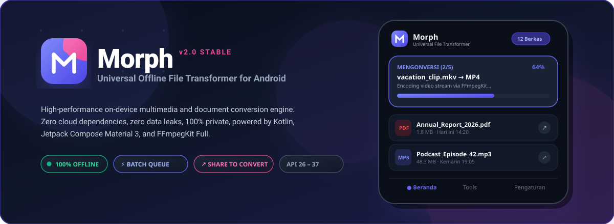
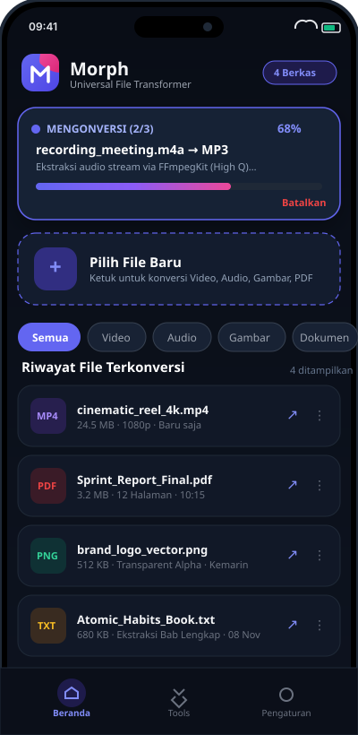
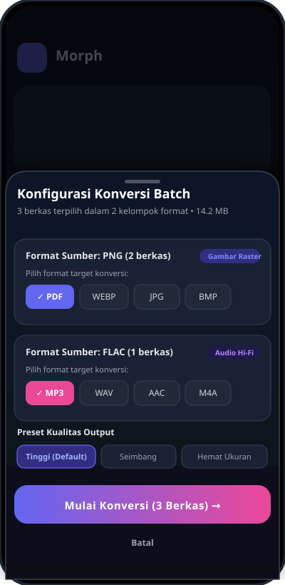
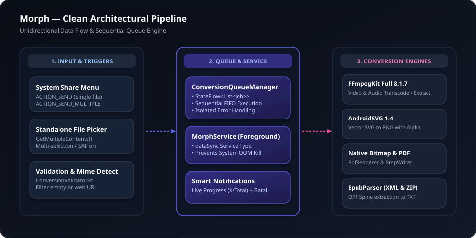

<!--
  ╔═════════════════════════════════════════════════════════════════════════════╗
  ║                                   MORPH                                     ║
  ║                   Universal Offline File Transformer for Android            ║
  ╚═════════════════════════════════════════════════════════════════════════════╝
-->

<div align="center">

  

  # Morph (Universal File Transformer)
  
  **A powerful, 100% private & offline native Android multimedia & document conversion engine.**

  [-3DDC84?style=for-the-badge&logo=android&logoColor=white)](https://developer.android.com)
  [](https://kotlinlang.org)
  [](https://developer.android.com/jetpack/compose)
  [](https://github.com/arthenica/ffmpeg-kit)
  [](LICENSE)
  [](#-zero-network--privacy-guarantee)

  <br />

  <p align="center">
    <a href="#-fitur-utama"><strong>Fitur Utama</strong></a> •
    <a href="#-tampilan-antarmuka-ui"><strong>Tampilan UI</strong></a> •
    <a href="#-matriks-dukungan-format"><strong>Format Didukung</strong></a> •
    <a href="#-arsitektur-dan-alur-kerja"><strong>Arsitektur</strong></a> •
    <a href="#-panduan-instalasi--build"><strong>Instalasi</strong></a> •
    <a href="#-kebijakan-privasi--izin"><strong>Privasi</strong></a> •
    <a href="#-lisensi--atribusi"><strong>Lisensi</strong></a>
  </p>

</div>

<br />

<div align="center">
  
</div>

<br />

---

## 🌟 Sorotan Utama (Key Highlights)

<table>
  <tr>
    <td width="50%" valign="top">
      <h3>🛡️ 100% Offline & Tanpa Kebocoran Data</h3>
      <p>Tidak meminta izin akses internet (<code>android.permission.INTERNET</code> ditiadakan). Seluruh proses konversi, ekstraksi audio, dan manipulasi berkas berjalan <b>murni di dalam perangkat</b> Anda tanpa ketergantungan server atau cloud pihak ketiga.</p>
    </td>
    <td width="50%" valign="top">
      <h3>⚡ Centralized Sequential Queue Manager</h3>
      <p>Mendukung antrean batch multi-file dan multi-format. Dikelola secara terpusat oleh <code>ConversionQueueManager</code> berbasis <code>StateFlow</code>. Kegagalan satu berkas tidak mematikan antrean berkas lainnya.</p>
    </td>
  </tr>
  <tr>
    <td width="50%" valign="top">
      <h3>🔔 Foreground Service & Smart Notifications</h3>
      <p>Dilengkapi <code>MorphService</code> dengan tipe <code>dataSync</code>. Konversi berlanjut mulus saat layar mati atau berpindah aplikasi. Dilengkapi notifikasi real-time interaktif (menampilkan posisi antrean <code>(X/Total)</code>, nama berkas, progres persentase, dan aksi pembatalan seketika).</p>
    </td>
    <td width="50%" valign="top">
      <h3>↗️ System-Wide "Share to Morph" Integration</h3>
      <p>Konversi instan tanpa harus membuka aplikasi terlebih dahulu. Cukup pilih satu atau beberapa file dari Galeri, File Manager, atau aplikasi pesan, lalu pilih <b>Morph</b> dari menu Bagikan (<code>ACTION_SEND</code> & <code>ACTION_SEND_MULTIPLE</code>).</p>
    </td>
  </tr>
</table>

<br />

---

## 📱 Tampilan Antarmuka (UI Showcase)

Morph dirancang menggunakan filosofi **Material 3** yang ekspresif, responsif, dan elegan dengan palet warna dinamis **Electric Indigo** (`#6366F1`) dan aksen **Neon Pink** (`#EC4899`).

<div align="center">
  <table border="0" cellspacing="10" cellpadding="0">
    <tr align="center">
      <td width="33%"><b>Beranda & Riwayat Berkas</b></td>
      <td width="33%"><b>Modal Bottom Sheet Konversi</b></td>
      <td width="33%"><b>Pusat Alat & Utilitas (Tools)</b></td>
    </tr>
    <tr align="center" valign="top">
      <td>
        
        <br /><br />
        <sub>Header statistik, pemantau live progress antrean, drop zone file, filter kategori, dan riwayat file.</sub>
      </td>
      <td>
        
        <br /><br />
        <sub>Pengelompokan otomatis berdasarkan ekstensi sumber, pemilihan format target per kelompok, dan preset kualitas.</sub>
      </td>
      <td>
        
        <br /><br />
        <sub>Katalog alat konversi mandiri (Video, PDF Toolkit, Ekstraksi Audio, SVG Rasterizer, EPUB Extractor).</sub>
      </td>
    </tr>
  </table>
</div>

<br />

---

## 🎯 Fitur & Kemampuan Konversi

Morph memanfaatkan kombinasi mesin **FFmpegKit Full**, pustaka rendering **AndroidSVG**, **PdfRenderer**, serta parser native Android.

```
📁 Input File (Video / Audio / Gambar / PDF / Vector / E-book)
     │
     ├── 🎬 Video Toolkit       ──► MP4, MKV, MOV, WEBM, GIF
     ├── 🎵 Audio Extraction    ──► MP3, M4A, AAC, WAV, FLAC, OGG, OPUS
     ├── 🖼️ Raster Image        ──► PNG, JPG, WEBP, BMP, PDF
     ├── 📐 Vector Graphics     ──► SVG ke PNG (Alpha Channel) / JPG / WEBP
     ├── 📄 PDF Toolkit         ──► Multi-page render ke JPG/PNG & Kompresi PDF
     └── 📖 E-Book Extractor    ──► EPUB ke TXT (OPF Spine Content Reader)
```

<br />

---

## 📊 Matriks Dukungan Format

<div align="center">

| Kategori | Format Input | Format Output yang Didukung | Keterangan Mesin / Fitur |
|:---|:---|:---|:---|
| **Video** | `MP4`, `MKV`, `MOV`, `WEBM`, `AVI` | `MP4`, `MKV`, `MOV`, `WEBM`, `GIF` | ⚡ Lossless Stream Copy jika codec kompatibel, transcode VP9/Opus untuk WEBM, filter orientasi potret & bounding-box GIF proporsional. |
| **Ekstraksi Audio** | `MP4`, `MKV`, `MOV`, `WEBM` | `MP3`, `M4A`, `WAV`, `FLAC`, `OGG`, `OPUS` | Ekstraksi langsung jalur audio dari video dengan preset bitrate dan sampling rate murni. |
| **Audio Transcode** | `FLAC`, `WAV`, `MP3`, `M4A`, `AAC` | `WAV`, `MP3`, `AAC`, `FLAC`, `M4A` | Dekode lossless PCM WAV, kompresi FLAC, transkode AAC/MP3 berkualitas tinggi. |
| **Gambar Raster** | `PNG`, `JPG`, `JPEG`, `WEBP`, `BMP` | `PNG`, `JPG`, `WEBP`, `BMP`, `PDF` | Penanganan transparansi alpha channel ke kanvas putih untuk JPG, konversi gambar tunggal ke halaman PDF. |
| **Grafik Vektor** | `SVG` | `PNG`, `JPG`, `WEBP` | Didukung **AndroidSVG 1.4** dengan retensi transparansi penuh pada format PNG. |
| **Dokumen PDF** | `PDF` | `JPG`, `PNG`, `PDF (Terkonversi)` | Render seluruh halaman PDF menjadi galeri gambar beresolusi tinggi atau kompresi cerdas berkas PDF. |
| **Buku Digital** | `EPUB` | `TXT` | Parser OPF spine XML & ekstraksi arsip ZIP untuk mengubah buku digital menjadi teks bersih. |

</div>

<br />

---

## 🏗️ Arsitektur dan Alur Kerja

Morph dibangun di atas prinsip arsitektur modern Android: **Single Source of Truth**, **Unidirectional Data Flow (UDF)**, dan **Isolation of Concerns**.

<div align="center">
  
</div>

<br />

### Alur Eksekusi Konversi:

1. **Ingress (Penerimaan Berkas):**
   - Berkas diterima baik dari *File Picker* internal (`ActivityResultContracts.GetMultipleContents()`) maupun intent sistem Android (`ACTION_SEND` / `ACTION_SEND_MULTIPLE`).
   - `ConversionValidator.kt` memfilter berkas: menolak tautan web/URL kosong dan memvalidasi tipe MIME berkas offline.

2. **Pengelompokan Cerdas (Grouping):**
   - `BottomSheetConverter.kt` mengelompokkan berkas terpilih berdasarkan format sumber (*grouped by extension*).
   - Pengguna dapat memilih format target berbeda untuk setiap kelompok dalam satu kali klik.

3. **Manajemen Antrean Sentral (Centralized Queue):**
   - Seluruh pekerjaan didaftarkan ke `ConversionQueueManager.kt` sebagai `ConversionJob`.
   - Menjalankan pekerjaan secara sekuensial (FIFO) sehingga memori perangkat tetap terkontrol dan mencegah *Out of Memory (OOM)*.

4. **Background Execution & Smart Notification:**
   - `MorphService.kt` diaktifkan sebagai *Foreground Service* dengan tipe `dataSync`.
   - Mengirimkan update progres langsung ke notifikasi sistem saat aplikasi diminimalkan atau layar dimatikan.
   - UI Jetpack Compose membaca data secara reaktif dari `StateFlow<List<ConversionJob>>`.

<br />

---

## 🛠️ Tech Stack & Spesifikasi Proyek

<div align="center">

| Komponen | Spesifikasi & Versi | Deskripsi & Peran |
|:---|:---|:---|
| **Bahasa Pemrograman** | **Kotlin 100%** | Bahasa utama dengan Coroutines & Flow |
| **Target SDK** | **Android 15 / API 37** (Compile SDK 37) | Dukungan fitur platform Android terbaru |
| **Min SDK** | **Android 8.0 / API 26** (Oreo) | Jangkauan kompatibilitas perangkat yang luas |
| **UI Framework** | **Jetpack Compose + Material 3** | Komponen antarmuka deklaratif modern & responsif |
| **Multimedia Engine** | **FFmpegKit Full 8.1.7** | Fork komunitas aktif dengan codec LAME, Vorbis, Opus, VPX |
| **Vector Engine** | **AndroidSVG 1.4** | Engine rendering SVG vector grafis ke bitmap |
| **Concurrency** | **Kotlin Coroutines & StateFlow** | Manajemen tugas asynchronous dan state UI reaktif |
| **Background Runner**| **Android Foreground Service** | Eksekusi antrean panjang di latar belakang secara stabil |
| **Build Tool** | **Gradle 9.6.0 & JDK 21** | Otomasi build modern, cepat, dan teruji |
| **Pengujian Unit** | **JUnit 4.13.2** | 100% unit tests passed (18/18 pengujian lulus) |

</div>

<br />

---

## 🚀 Panduan Instalasi & Build

### Prasyarat:
- **Android Studio** Ladybug (2024.2.1+) atau versi lebih baru
- **JDK 21** terpasang dan dikonfigurasi pada environment path
- Perangkat Android fisik atau Emulator (Android 8.0 / API 26 ke atas)

### 1. Kloning Repositori
```bash
git clone https://github.com/RizkyFauzi06/Morph.git
cd Morph
```

### 2. Jalankan Pengujian Otomatis (Unit Tests)
```powershell
# Windows
.\gradlew test

# Linux / macOS
./gradlew test
```

### 3. Kompilasi Debug APK
```powershell
# Windows
.\gradlew assembleDebug

# Linux / macOS
./gradlew assembleDebug
```
Berkas APK hasil kompilasi akan tersedia di:  
`app/build/outputs/apk/debug/app-debug.apk`

---

## 🔒 Kebijakan Privasi & Izin

Morph menjamin **100% privasi pengguna**. Berkas Anda adalah milik Anda sepenuhnya.

| Izin Android | Tujuan Penggunaan | Wajib? |
|:---|:---|:---:|
| `android.permission.POST_NOTIFICATIONS` | Menampilkan progres konversi antrean dan notifikasi selesai di Android 13+ (API 33+). | Opsional |
| `android.permission.FOREGROUND_SERVICE` | Menjaga proses konversi tetap berjalan tanpa dihentikan sistem saat pengguna keluar dari aplikasi. | Wajib |
| `android.permission.FOREGROUND_SERVICE_DATA_SYNC` | Mengklasifikasikan proses konversi data lokal sesuai kebijakan Android 14+. | Wajib |
| ❌ `android.permission.INTERNET` | **DITIADAKAN.** Morph tidak dapat dan tidak akan pernah terhubung ke internet. | **TIDAK ADA** |

<br />

---

## ⚖️ Lisensi & Atribusi

Proyek Morph didistribusikan di bawah lisensi open source dengan ketentuan:

- **Morph Source Code & Proyek Utama:** Dilindungi di bawah lisensi **GNU General Public License v3.0 (GPLv3)**. Silakan baca berkas [LICENSE](LICENSE) untuk detail lengkap.
- **FFmpegKit (Full):** Berlisensi di bawah **GPLv3** (`dev.ffmpegkit-maintained:ffmpeg-kit-full:8.1.7`).
- **AndroidSVG:** Berlisensi di bawah **Apache License 2.0** (`com.caverock:androidsvg-aar:1.4`).
- **Smart Exception Java:** Berlisensi di bawah **Apache License 2.0** (`com.arthenica:smart-exception-java:0.2.1`).

---

<div align="center">
  <sub>Dikembangkan dengan sepenuh hati menggunakan <b>Kotlin</b> & <b>Jetpack Compose</b>.</sub>
  <br />
  <sub>Copyright © 2026 <b>Rizky Fauzi</b>. All rights reserved.</sub>
</div>
