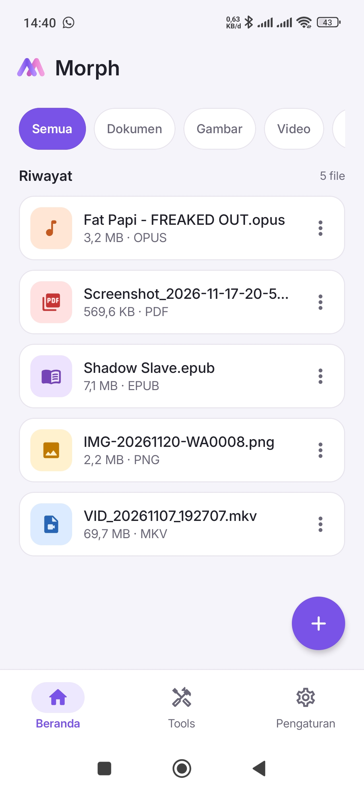

<div align="center">

  

  <h1>Morph</h1>
  <p><strong>Offline File Converter for Android</strong></p>

  <p>
    <strong>English</strong> &nbsp;|&nbsp; <a href="README/README.id.md">Bahasa Indonesia</a>
  </p>

  <p>
    <a href="https://github.com/RizkyFauzi06/Morph/releases"></a>
    
    
    
    <a href="LICENSE"></a>
  </p>

  <p>
    <a href="#features">Features</a> &nbsp;&bull;&nbsp;
    <a href="#supported-formats">Supported Formats</a> &nbsp;&bull;&nbsp;
    <a href="#installation">Installation</a> &nbsp;&bull;&nbsp;
    <a href="#how-to-use">How to Use</a> &nbsp;&bull;&nbsp;
    <a href="#privacy--permissions">Privacy &amp; Permissions</a> &nbsp;&bull;&nbsp;
    <a href="#tech-stack--license">Tech Stack &amp; License</a>
  </p>

</div>

<hr />

<p>
  <strong>Morph</strong> is a local, offline-first file converter for Android built with Kotlin and Jetpack Compose. It allows you to convert videos, audio tracks, raster images, vector graphics, PDF documents, and e-books directly on your device—with no cloud uploads, no accounts, and no tracking.
</p>

<h2 id="features">Features</h2>

<table>
  <tr>
    <td width="50%" valign="top">
      <h3>Offline Engine &amp; Private</h3>
      <p>Every conversion, audio extraction, and document operation runs 100% locally on your device, ensuring your files never leave your phone. Minimal internet access is used solely to check for new GitHub releases (optional).</p>
    </td>
    <td width="50%" valign="top">
      <h3>Batch Conversion</h3>
      <p>Select multiple files of different types in a single session. Morph automatically groups files by source format so you can assign independent target formats and quality presets per group.</p>
    </td>
  </tr>
  <tr>
    <td width="50%" valign="top">
      <h3>Share to Morph</h3>
      <p>Send single or multiple files directly from your Gallery, File Manager, or browsers via Android's native <strong>Share</strong> sheet without opening the main app—complete with an optional auto-close mode.</p>
    </td>
    <td width="50%" valign="top">
      <h3>Background Queue &amp; Notifications</h3>
      <p>Powered by a sequential conversion queue and an Android Foreground Service. Conversions continue reliably when minimized or with the screen off, complete with real-time progress notifications.</p>
    </td>
  </tr>
</table>

<h2 id="interface--workflow-preview">Interface &amp; Workflow Preview</h2>

<div align="center">
  <table>
    <tr>
      <td width="50%" align="center" valign="top">
        
        <br /><br />
        <strong>Homescreen &amp; File History</strong>
        <br />
        <sub>Quick file picker, category filters (Documents, Images, Video, Audio), and local conversion history management.</sub>
      </td>
      <td width="50%" align="center" valign="top">
        
        <br /><br />
        <strong>Share to Morph</strong>
        <br />
        <sub>Trigger conversions directly from Gallery, File Manager, or other apps via the native Android Share sheet.</sub>
      </td>
    </tr>
    <tr>
      <td width="50%" align="center" valign="top">
        
        <br /><br />
        <strong>Direct Web Format Conversion</strong>
        <br />
        <sub>Share images directly from Google/browsers ("Share image") or convert web formats (WebP, WebM, SVG) into standard offline-ready files without saving them first.</sub>
      </td>
      <td width="50%" align="center" valign="top">
        
        <br /><br />
        <strong>Batch Conversion</strong>
        <br />
        <sub>Automatically groups multiple selected files by source extension with independent target formats and quality presets.</sub>
      </td>
    </tr>
  </table>
</div>

<h2 id="supported-formats">Supported Formats</h2>

<p>
  All converted files are saved directly to your device's <code>Downloads/Morph</code> directory, with an option to preserve original filenames.
</p>

<table>
  <thead>
    <tr>
      <th align="left">Tool / Category</th>
      <th align="left">Input Formats</th>
      <th align="left">Output Formats</th>
      <th align="left">Capabilities &amp; Notes</th>
    </tr>
  </thead>
  <tbody>
    <tr>
      <td><strong>Video Conversion</strong></td>
      <td><code>MP4</code>, <code>MKV</code>, <code>MOV</code>, <code>WEBM</code>, <code>AVI</code></td>
      <td><code>MP4</code>, <code>MKV</code>, <code>MOV</code>, <code>WEBM</code>, <code>GIF</code></td>
      <td>Supports <strong>Instant</strong> lossless stream copy for compatible containers, VP9/Opus encoding for WebM, and aspect-ratio preserved animated GIF export.</td>
    </tr>
    <tr>
      <td><strong>Audio Extraction</strong></td>
      <td><code>MP4</code>, <code>MKV</code>, <code>MOV</code>, <code>WEBM</code></td>
      <td><code>MP3</code>, <code>M4A</code>, <code>WAV</code>, <code>FLAC</code>, <code>OGG</code>, <code>OPUS</code></td>
      <td>Extracts audio tracks directly from video files with configurable quality presets.</td>
    </tr>
    <tr>
      <td><strong>Audio Conversion</strong></td>
      <td><code>MP3</code>, <code>WAV</code>, <code>FLAC</code>, <code>AAC</code>, <code>M4A</code>, <code>OGG</code>, <code>OPUS</code></td>
      <td><code>MP3</code>, <code>WAV</code>, <code>AAC</code>, <code>FLAC</code>, <code>M4A</code>, <code>OGG</code>, <code>OPUS</code></td>
      <td>Uncompressed PCM WAV, lossless FLAC, high-bitrate MP3/AAC, and <strong>Instant</strong> stream copy for compatible M4A/AAC streams.</td>
    </tr>
    <tr>
      <td><strong>Image Conversion</strong></td>
      <td><code>PNG</code>, <code>JPG</code>, <code>JPEG</code>, <code>WEBP</code>, <code>BMP</code></td>
      <td><code>PNG</code>, <code>JPG</code>, <code>WEBP</code>, <code>BMP</code>, <code>PDF</code></td>
      <td>Automatic white canvas compositing when converting transparent images to JPG. Multiple images can be merged into a single PDF or exported separately.</td>
    </tr>
    <tr>
      <td><strong>SVG Conversion</strong></td>
      <td><code>SVG</code></td>
      <td><code>PNG</code>, <code>JPG</code>, <code>WEBP</code></td>
      <td>High-resolution vector rasterization powered by AndroidSVG with full alpha transparency retention on PNG.</td>
    </tr>
    <tr>
      <td><strong>PDF Toolkit</strong></td>
      <td><code>PDF</code></td>
      <td><code>JPG</code>, <code>PNG</code>, <code>WEBP</code>, <code>PDF</code></td>
      <td>Render multi-page PDFs into individual high-resolution images or compress existing PDF file sizes.</td>
    </tr>
    <tr>
      <td><strong>EPUB Text Extraction</strong></td>
      <td><code>EPUB</code></td>
      <td><code>TXT</code></td>
      <td>Parses OPF spine structure to extract clean, readable plain text from digital books.</td>
    </tr>
  </tbody>
</table>

<h3>Quality Presets</h3>
<ul>
  <li><strong>High:</strong> Retains maximum resolution and original bitrate with minimal compression.</li>
  <li><strong>Medium:</strong> Balanced output quality and file size reduction (~50%).</li>
  <li><strong>Low:</strong> Aggressive compression and downscaling to save storage space.</li>
  <li><strong>Instant:</strong> Remuxes compatible media containers without re-encoding for near-instant processing and zero quality loss.</li>
</ul>

<h2 id="installation">Installation</h2>

<h3>Option 1: Install APK (Recommended)</h3>
<p>
  You do not need to clone or build the source code to use Morph:
</p>
<ol>
  <li>Go to the <a href="https://github.com/RizkyFauzi06/Morph/releases"><strong>Releases</strong></a> section of this repository.</li>
  <li>Download the latest <code>Morph-v*.apk</code> from <a href="https://github.com/RizkyFauzi06/Morph/releases/latest">GitHub Releases</a>.</li>
  <li>Open the downloaded APK on your Android device (Android 8.0 or newer) and allow installation from your browser or file manager if prompted.</li>
</ol>

<h3>Option 2: Build from Source</h3>
<p>
  If you want to inspect or compile the project yourself, ensure you have <strong>Android Studio</strong> and <strong>JDK 21</strong> installed:
</p>

```bash
git clone [https://github.com/RizkyFauzi06/Morph.git](https://github.com/RizkyFauzi06/Morph.git)
cd Morph

# Compile Debug APK
./gradlew assembleDebug
```

<p>
  The compiled APK will be generated at <code>app/build/outputs/apk/debug/app-debug.apk</code>.
</p>

<h2 id="how-to-use">How to Use</h2>

<h3>1. Convert Directly via Homescreen</h3>
<ol>
  <li>Open <strong>Morph</strong> and tap <strong>Select File</strong> on the <strong>Homescreen</strong>.</li>
  <li>Pick one or multiple files from your device (videos, audio, images, web formats like WebP/WebM/SVG, PDFs, or EPUBs).</li>
  <li>Choose your <strong>Target Format</strong> and <strong>Quality Preset</strong> (<strong>High</strong>, <strong>Medium</strong>, <strong>Low</strong>, or <strong>Instant</strong> lossless stream copy for compatible media).</li>
  <li><em>(Optional)</em> Toggle <strong>Merge into a single PDF</strong> when selecting multiple images.</li>
  <li>Tap <strong>Convert</strong>. Tasks run reliably via <strong>Background Queue &amp; Notifications</strong>, and all converted files are saved to <code>Downloads/Morph</code>.</li>
</ol>

<h3>2. Share from Other Apps (Share to Morph)</h3>
<ol>
  <li>Select one or more files in your <strong>Gallery</strong>, <strong>File Manager</strong>, or tap <strong>Share image</strong> directly on an image in Google/your mobile browser.</li>
  <li>Choose <strong>Morph</strong> from Android's <strong>Share</strong> sheet.</li>
  <li>Select your target format in the pop-up sheet and tap <strong>Convert</strong> without leaving your current app.</li>
</ol>

<h3>3. Manage Your File History</h3>
<ul>
  <li>Filter converted files by category on the <strong>Homescreen</strong>, or tap any item in your <strong>File History</strong> to open, share, or delete it.</li>
  <li>Enable <strong>Auto-Close (Share)</strong> or <strong>Keep Original Filename</strong> in <strong>Settings</strong> to customize your workflow.</li>
</ul>

<h2 id="privacy--permissions">Privacy &amp; Permissions</h2>

<p><strong>Offline Engine &amp; Private:</strong> All file conversions, media transcoding, and document parsing run 100% locally on your device. Morph has no backend servers, no analytics, and never uploads your files.</p>

<table>
  <thead>
    <tr>
      <th align="left">Android Permission / Setting</th>
      <th align="left">Purpose</th>
      <th align="center">Status</th>
    </tr>
  </thead>
  <tbody>
    <tr>
      <td><code>INTERNET</code></td>
      <td>Used <strong>exclusively</strong> to check for new app releases via the GitHub API (can be disabled in Settings). Never used during file conversion.</td>
      <td align="center">Optional</td>
    </tr>
    <tr>
      <td><code>POST_NOTIFICATIONS</code></td>
      <td>Displays real-time conversion queue progress and completion alerts on Android 13+.</td>
      <td align="center">Optional</td>
    </tr>
    <tr>
      <td><code>FOREGROUND_SERVICE</code> &amp; <code>FOREGROUND_SERVICE_DATA_SYNC</code></td>
      <td>Keeps active local conversions running smoothly when you switch apps or lock your screen.</td>
      <td align="center">Required</td>
    </tr>
    <tr>
      <td><code>Unrestricted Battery Usage</code> <em>(System Setting)</em></td>
      <td>Prevents Android's battery saver from terminating long video or audio conversions in the background (configured manually via App Info).</td>
      <td align="center">Recommended</td>
    </tr>
  </tbody>
</table>

<h2 id="tech-stack--license">Tech Stack &amp; License</h2>

<ul>
  <li><strong>Language &amp; UI:</strong> Kotlin, Jetpack Compose, AndroidX, &amp; Kotlin Coroutines (Apache License 2.0).</li>
  <li><strong>Core Libraries (Third-Party Engines):</strong>
    <ul>
      <li><strong>FFmpegKit Full (8.1.7)</strong> — Audio/video processing (License: <strong>GPL-3.0 / LGPL-3.0</strong>).</li>
      <li><strong>AndroidSVG (1.4)</strong> by Paul LeBeau — SVG vector graphics rendering (License: <strong>Apache License 2.0</strong>).</li>
      <li><strong>Android Native SDK</strong> — <code>PdfRenderer</code>, <code>PdfDocument</code>, &amp; <code>java.util.zip</code> for PDF rendering and EPUB parsing.</li>
    </ul>
  </li>
  <li><strong>Morph Project License:</strong> Distributed under the <a href="LICENSE"><strong>GNU General Public License v3.0 (GPL-3.0)</strong></a>.</li>
</ul>

<hr />

<div align="center">
  <p>Designed and developed by <strong>Rizki Fauzi</strong>.</p>
</div>