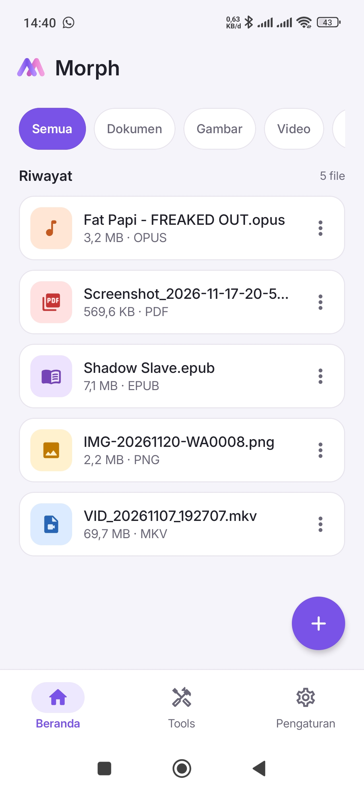

<div align="center">

  

  <h1>Morph</h1>
  <p><strong>Offline File Converter untuk Android</strong></p>

  <p>
    <a href="../README.md">English</a> &nbsp;|&nbsp; <strong>Bahasa Indonesia</strong>
  </p>

  <p>
    <a href="https://github.com/RizkyFauzi06/Morph/releases"></a>
    
    
    
    <a href="../LICENSE"></a>
  </p>

  <p>
    <a href="#fitur">Fitur</a> &nbsp;&bull;&nbsp;
    <a href="#format-yang-didukung">Format yang Didukung</a> &nbsp;&bull;&nbsp;
    <a href="#instalasi">Instalasi</a> &nbsp;&bull;&nbsp;
    <a href="#cara-penggunaan">Cara Penggunaan</a> &nbsp;&bull;&nbsp;
    <a href="#privasi--izin">Privasi &amp; Izin</a> &nbsp;&bull;&nbsp;
    <a href="#tech-stack--lisensi">Tech Stack &amp; Lisensi</a>
  </p>

</div>

<hr />

<p>
  <strong>Morph</strong> adalah aplikasi konverter file lokal (<em>offline-first</em>) untuk Android yang dibangun dengan Kotlin dan Jetpack Compose. Aplikasi ini memungkinkan Anda mengonversi video, trek audio, gambar raster, grafik vektor, dokumen PDF, dan e-book langsung di perangkat—tanpa unggahan cloud, tanpa akun, dan tanpa pelacakan.
</p>

<h2 id="fitur">Fitur</h2>

<table>
  <tr>
    <td width="50%" valign="top">
      <h3>Offline Engine &amp; Private</h3>
      <p>Seluruh proses konversi, ekstraksi audio, dan pengolahan dokumen berjalan 100% secara lokal di perangkat Anda, memastikan file tidak pernah keluar dari ponsel. Akses internet minimal hanya digunakan untuk memeriksa pembaruan rilis di GitHub (opsional).</p>
    </td>
    <td width="50%" valign="top">
      <h3>Batch Conversion</h3>
      <p>Pilih banyak file dengan berbagai format sekaligus dalam satu sesi. Morph otomatis mengelompokkan file berdasarkan format asalnya sehingga Anda dapat menentukan format tujuan dan preset kualitas secara terpisah untuk tiap kelompok.</p>
    </td>
  </tr>
  <tr>
    <td width="50%" valign="top">
      <h3>Share to Morph</h3>
      <p>Kirim satu atau beberapa file langsung dari Galeri, File Manager, atau browser melalui menu <strong>Share</strong> bawaan Android tanpa perlu membuka aplikasi utamanya—dilengkapi opsi tutup otomatis (<em>Auto-Close</em>).</p>
    </td>
    <td width="50%" valign="top">
      <h3>Background Queue &amp; Notifications</h3>
      <p>Didukung antrean konversi berurutan dan <em>Foreground Service</em> Android. Proses konversi tetap berjalan lancar saat aplikasi diminimalkan atau layar mati, lengkap dengan notifikasi progres <em>real-time</em>.</p>
    </td>
  </tr>
  <tr>
    <td width="50%" valign="top">
      <h3>Folder Output Kustom <sup>v1.1.0</sup></h3>
      <p>Simpan hasil ke folder mana pun yang Anda pilih (memori internal atau kartu SD) lewat pemilih folder Android, dengan mode opsional <strong>Subfolder per File</strong> (<code>Buku.pdf</code> &rarr; <code>Buku/</code>). Jika akses folder dicabut, Morph kembali ke <code>Downloads/Morph</code> dengan aman.</p>
    </td>
    <td width="50%" valign="top">
      <h3>Resolusi &amp; Frame Rate Video <sup>v1.1.0</sup></h3>
      <p>Perkecil video secara opsional ke <strong>1080p</strong>, <strong>720p</strong>, atau <strong>480p</strong> (rasio aspek terjaga) dan ubah frame rate ke <strong>60</strong>, <strong>30</strong>, atau <strong>24 fps</strong>.</p>
    </td>
  </tr>
</table>

<h2 id="tampilan--alur-kerja">Tampilan &amp; Alur Kerja</h2>

<div align="center">
  <table>
    <tr>
      <td width="50%" align="center" valign="top">
        
        <br /><br />
        <strong>Homescreen &amp; File History</strong>
        <br />
        <sub>Pemilih file cepat, filter kategori (Dokumen, Gambar, Video, Audio), dan pengelolaan riwayat konversi lokal.</sub>
      </td>
      <td width="50%" align="center" valign="top">
        
        <br /><br />
        <strong>Share to Morph</strong>
        <br />
        <sub>Mulai konversi langsung dari Galeri, File Manager, atau aplikasi lain melalui menu Share bawaan Android.</sub>
      </td>
    </tr>
    <tr>
      <td width="50%" align="center" valign="top">
        
        <br /><br />
        <strong>Direct Web Format Conversion</strong>
        <br />
        <sub>Bagikan gambar langsung dari Google/browser ("Bagikan gambar" / "Share image") atau konversi format web (WebP, WebM, SVG) menjadi file standar siap offline tanpa perlu mengunduhnya terlebih dahulu.</sub>
      </td>
      <td width="50%" align="center" valign="top">
        
        <br /><br />
        <strong>Batch Conversion</strong>
        <br />
        <sub>Mengelompokkan beberapa file terpilih secara otomatis berdasarkan ekstensi sumber dengan format tujuan dan preset kualitas masing-masing.</sub>
      </td>
    </tr>
  </table>
</div>

<h2 id="format-yang-didukung">Format yang Didukung</h2>

<p>
  Hasil konversi disimpan ke <code>Downloads/Morph</code> secara bawaan, atau ke folder pilihan Anda (<strong>Pengaturan &rarr; Folder Output</strong>), dengan opsi mempertahankan nama file asli dan mengelompokkan hasil ke subfolder per file.
</p>

<table>
  <thead>
    <tr>
      <th align="left">Alat / Kategori</th>
      <th align="left">Format Input</th>
      <th align="left">Format Output</th>
      <th align="left">Kemampuan &amp; Catatan</th>
    </tr>
  </thead>
  <tbody>
    <tr>
      <td><strong>Video Conversion</strong></td>
      <td><code>MP4</code>, <code>MKV</code>, <code>MOV</code>, <code>WEBM</code>, <code>AVI</code>, <code>FLV</code>, <code>WMV</code>, <code>3GP</code>, <code>M4V</code>, <code>TS</code>, <code>OGV</code></td>
      <td><code>MP4</code>, <code>MKV</code>, <code>MOV</code>, <code>WEBM</code>, <code>AVI</code>, <code>GIF</code></td>
      <td>Mendukung <em>stream copy</em> lossless <strong>Instant</strong> bila codec sumber cocok dengan kontainer tujuan (jika tidak, otomatis di-<em>encode</em> ulang), encoding H.264 cepat (hardware bila menaati bitrate, jika tidak memakai mesin x264 bawaan), opsi resolusi (1080p/720p/480p) dan frame rate (60/30/24 fps; video yang lebih kecil tidak pernah diperbesar), encoding VP8/Opus untuk WebM (bisa diputar di semua versi Android), serta ekspor GIF animasi dengan rasio aspek terjaga. Trek audio yang cocok dipertahankan apa adanya. <em>Kompres</em> (format sama) tersedia untuk MP4, MKV, MOV, WebM, dan AVI.</td>
    </tr>
    <tr>
      <td><strong>Video to Audio Extraction</strong></td>
      <td><code>MP4</code>, <code>MKV</code>, <code>MOV</code>, <code>WEBM</code>, <code>AVI</code>, <code>FLV</code>, <code>WMV</code>, <code>3GP</code>, <code>M4V</code>, <code>TS</code>, <code>OGV</code></td>
      <td><code>MP3</code>, <code>M4A</code>, <code>WAV</code>, <code>FLAC</code>, <code>OGG</code>, <code>OPUS</code></td>
      <td>Mengekstrak jalur audio langsung dari file video dengan pilihan preset kualitas. Video tanpa trek audio mendapat pesan yang jelas, bukan file kosong.</td>
    </tr>
    <tr>
      <td><strong>Audio Conversion</strong></td>
      <td><code>MP3</code>, <code>WAV</code>, <code>FLAC</code>, <code>AAC</code>, <code>M4A</code>, <code>OGG</code>, <code>OPUS</code>, <code>WMA</code>, <code>AIFF</code>, <code>AMR</code></td>
      <td><code>MP3</code>, <code>WAV</code>, <code>AAC</code>, <code>FLAC</code>, <code>M4A</code>, <code>OGG</code>, <code>OPUS</code></td>
      <td>Mendukung PCM WAV tanpa kompresi, FLAC lossless, MP3/AAC bitrate tinggi, OGG Vorbis juga untuk rekaman mono dan suara, serta <em>stream copy</em> <strong>Instant</strong> bila codec audio sumber sudah sesuai dengan format tujuan (High juga mempertahankan trek yang cocok apa adanya).</td>
    </tr>
    <tr>
      <td><strong>Image Conversion</strong></td>
      <td><code>PNG</code>, <code>JPG</code>, <code>JPEG</code>, <code>WEBP</code>, <code>BMP</code>, <code>GIF</code>, <code>HEIC</code>, <code>HEIF</code>, <code>ICO</code></td>
      <td><code>PNG</code>, <code>JPG</code>, <code>WEBP</code>, <code>BMP</code>, <code>PDF</code></td>
      <td>Pengisian latar belakang putih otomatis saat mengonversi gambar transparan ke JPG/BMP. Banyak gambar dapat digabung menjadi satu PDF yang ringkas (halaman JPEG) atau diekspor terpisah. GIF memakai frame pertamanya; HEIC/HEIF butuh Android 9+. TIFF tidak didukung (Android tidak punya decoder TIFF).</td>
    </tr>
    <tr>
      <td><strong>SVG Conversion</strong></td>
      <td><code>SVG</code></td>
      <td><code>PNG</code>, <code>JPG</code>, <code>WEBP</code></td>
      <td>Rasterisasi vektor resolusi tinggi menggunakan AndroidSVG dengan mempertahankan transparansi penuh pada PNG.</td>
    </tr>
    <tr>
      <td><strong>PDF Toolkit</strong></td>
      <td><code>PDF</code></td>
      <td><code>JPG</code>, <code>PNG</code>, <code>PDF</code></td>
      <td>Merender halaman PDF menjadi gambar resolusi tinggi terpisah (aman memori untuk halaman besar) atau mengompres PDF, lengkap dengan hasil ukuran aktual saat selesai (misalnya <code>2.4 MB &rarr; 850 KB (-65%)</code>).</td>
    </tr>
    <tr>
      <td><strong>EPUB &hArr; TXT</strong></td>
      <td><code>EPUB</code>, <code>TXT</code></td>
      <td><code>TXT</code>, <code>EPUB</code></td>
      <td>Mengurai <em>spine</em> OPF untuk mengekstrak teks polos yang bersih dari buku EPUB, serta menyusun buku EPUB standar dari file TXT dengan deteksi bab otomatis (<em>Bab 1</em>, <em>Chapter 2</em>, &hellip;) dan daftar isi.</td>
    </tr>
  </tbody>
</table>

<h3>Quality Presets (Preset Kualitas)</h3>
<ul>
  <li><strong>High:</strong> Mempertahankan resolusi maksimal dan bitrate asli dengan kompresi minimal.</li>
  <li><strong>Medium:</strong> Kualitas output seimbang dengan pengurangan ukuran file (~50%).</li>
  <li><strong>Low:</strong> Kompresi agresif dan penyesuaian skala untuk menghemat ruang penyimpanan.</li>
  <li><strong>Instant:</strong> Melakukan <em>remux</em> pada kontainer media yang kompatibel tanpa <em>re-encode</em> untuk proses hampir instan dan kualitas 100% utuh tanpa penurunan.</li>
</ul>

<h2 id="instalasi">Instalasi</h2>

<h3>Opsi 1: Pasang APK (Direkomendasikan)</h3>
<p>
  Anda tidak perlu melakukan clone atau build kode sumber untuk menggunakan Morph:
</p>
<ol>
  <li>Buka bagian <a href="https://github.com/RizkyFauzi06/Morph/releases"><strong>Releases</strong></a> pada repositori ini.</li>
  <li>Unduh file <code>Morph-v*.apk</code> terbaru dari <a href="https://github.com/RizkyFauzi06/Morph/releases/latest">GitHub Releases</a>.</li>
  <li>Buka file APK yang telah diunduh di perangkat Android Anda (Android 8.0 atau lebih baru, <strong>64-bit</strong>) dan izinkan instalasi dari browser atau file manager jika diminta. HP dengan Android 32-bit (umum di Android Go dan sebagian model murah) belum didukung, karena engine FFmpeg hanya menyediakan library 64-bit.</li>
</ol>

<h3>Opsi 2: Build dari Source Code</h3>
<p>
  Untuk memeriksa atau mengompilasi proyek ini sendiri, Anda memerlukan:
</p>
<ul>
  <li><strong>JDK 21</strong></li>
  <li><strong>Android SDK</strong> (cukup Command-Line Tools, misalnya bersama VS Code) <strong>atau Android Studio</strong></li>
</ul>
<p>
  Arahkan Gradle ke SDK Anda melalui variabel lingkungan <code>ANDROID_HOME</code> atau file <code>local.properties</code> berisi <code>sdk.dir=/path/ke/Android/sdk</code>, lalu jalankan:
</p>

```bash
git clone https://github.com/RizkyFauzi06/Morph.git
cd Morph

# Kompilasi Debug APK
./gradlew assembleDebug
```

<p>
  File APK hasil kompilasi akan tersedia di <code>app/build/outputs/apk/debug/app-debug.apk</code>.
</p>

<h2 id="cara-penggunaan">Cara Penggunaan</h2>

<h3>1. Konversi Langsung melalui Homescreen</h3>
<ol>
  <li>Buka <strong>Morph</strong> dan ketuk <strong>Pilih File</strong> pada layar <strong>Homescreen</strong>.</li>
  <li>Pilih satu atau beberapa file dari perangkat Anda (video, audio, gambar, format web seperti WebP/WebM/SVG, PDF, atau EPUB).</li>
  <li>Pilih <strong>Format Tujuan</strong> dan <strong>Quality Preset</strong> (<strong>High</strong>, <strong>Medium</strong>, <strong>Low</strong>, atau <em>stream copy</em> lossless <strong>Instant</strong> untuk media yang kompatibel).</li>
  <li><em>(Opsional)</em> Aktifkan sakelar <strong>Gabung menjadi satu PDF</strong> saat memilih beberapa file gambar, atau pilih <strong>Resolusi</strong> dan <strong>Frame Rate</strong> saat mengonversi video ke video.</li>
  <li>Ketuk <strong>Konversi</strong>. Tugas berjalan aman melalui <strong>Background Queue &amp; Notifications</strong>, dan hasil konversi disimpan ke folder output Anda (bawaan: <code>Downloads/Morph</code>).</li>
</ol>

<h3>2. Bagikan dari Aplikasi Lain (Share to Morph)</h3>
<ol>
  <li>Pilih satu atau beberapa file di <strong>Galeri</strong>, <strong>File Manager</strong>, atau ketuk <strong>Bagikan gambar</strong> (<em>Share image</em>) langsung pada gambar di Google/browser seluler.</li>
  <li>Pilih <strong>Morph</strong> dari menu <strong>Share</strong> bawaan Android.</li>
  <li>Pilih format tujuan pada panel <em>bottom sheet</em> yang muncul dan ketuk <strong>Konversi</strong> tanpa meninggalkan aplikasi yang sedang dibuka.</li>
</ol>

<h3>3. Kelola File History</h3>
<ul>
  <li>Filter file hasil konversi berdasarkan kategori di <strong>Homescreen</strong>, atau ketuk item mana pun pada <strong>File History</strong> untuk membuka, membagikan, atau menghapusnya.</li>
  <li>Aktifkan <strong>Tutup Otomatis (Share)</strong> atau <strong>Pertahankan Nama Asli</strong> di <strong>Pengaturan</strong> untuk menyesuaikan alur kerja Anda.</li>
  <li>Pilih <strong>Folder Output</strong> kustom dan aktifkan <strong>Subfolder per File</strong> di <strong>Pengaturan</strong>. File yang tersimpan di sana juga muncul di Riwayat File.</li>
</ul>

<h2 id="privasi--izin">Privasi &amp; Izin</h2>

<p><strong>Offline Engine &amp; Private:</strong> Seluruh konversi file, transcoding media, dan penguraian dokumen berjalan 100% secara lokal di perangkat Anda. Morph tidak memiliki server backend, tidak ada analitik, dan tidak pernah mengunggah file Anda.</p>

<table>
  <thead>
    <tr>
      <th align="left">Izin / Pengaturan Android</th>
      <th align="left">Tujuan</th>
      <th align="center">Status</th>
    </tr>
  </thead>
  <tbody>
    <tr>
      <td><code>INTERNET</code></td>
      <td>Digunakan <strong>khusus</strong> untuk memeriksa rilis aplikasi baru melalui GitHub API (dapat dimatikan di Pengaturan). Tidak pernah digunakan saat proses konversi file.</td>
      <td align="center">Opsional</td>
    </tr>
    <tr>
      <td><code>POST_NOTIFICATIONS</code></td>
      <td>Menampilkan progres antrean konversi secara <em>real-time</em> dan notifikasi selesai pada Android 13+.</td>
      <td align="center">Opsional</td>
    </tr>
    <tr>
      <td><code>FOREGROUND_SERVICE</code>, <code>FOREGROUND_SERVICE_DATA_SYNC</code> &amp; <code>FOREGROUND_SERVICE_MEDIA_PROCESSING</code></td>
      <td>Menjaga proses konversi lokal tetap berjalan lancar saat Anda berpindah aplikasi atau mengunci layar (tipe media-processing di Android 15+, data-sync sebelumnya).</td>
      <td align="center">Wajib</td>
    </tr>
    <tr>
      <td><code>Unrestricted Battery Usage</code> <em>(Pengaturan Sistem)</em></td>
      <td>Mencegah penghemat baterai Android menghentikan konversi video atau audio berdurasi panjang di latar belakang (diatur manual melalui Info Aplikasi).</td>
      <td align="center">Direkomendasikan</td>
    </tr>
    <tr>
      <td><code>WRITE_EXTERNAL_STORAGE</code> / <code>READ_EXTERNAL_STORAGE</code></td>
      <td>Hanya diminta di Android 8&ndash;10 untuk menyimpan dan menampilkan file di <code>Downloads/Morph</code>. Tidak dipakai di Android 11+.</td>
      <td align="center">Android 8&ndash;10</td>
    </tr>
    <tr>
      <td>Akses folder <em>(Storage Access Framework)</em></td>
      <td>Hanya diberikan untuk folder output kustom yang Anda pilih. Dapat dicabut kapan saja; Morph lalu memakai <code>Downloads/Morph</code>.</td>
      <td align="center">Opsional</td>
    </tr>
  </tbody>
</table>

<h2 id="tech-stack--lisensi">Tech Stack &amp; Lisensi</h2>

<ul>
  <li><strong>Bahasa &amp; UI:</strong> Kotlin, Jetpack Compose, AndroidX, &amp; Kotlin Coroutines (Apache License 2.0).</li>
  <li><strong>Pustaka Inti (Mesin Pihak Ketiga):</strong>
    <ul>
      <li><strong>FFmpegKit Full (8.1.7)</strong> — Pemrosesan audio/video (Lisensi: <strong>GPL-3.0 / LGPL-3.0</strong>).</li>
      <li><strong>x264 (build 165)</strong> — Encoder H.264 software native (NEON) di <code>libmorph-native.so</code> (Lisensi: <strong>GPL-2.0-or-later</strong>).</li>
      <li><strong>AndroidSVG (1.4)</strong> oleh Paul LeBeau — Rendering grafik vektor SVG (Lisensi: <strong>Apache License 2.0</strong>).</li>
      <li><strong>Android Native SDK</strong> — <code>PdfRenderer</code>, penulis PDF halaman-JPEG kecil, &amp; <code>java.util.zip</code> untuk rendering dan penulisan PDF, penguraian EPUB, dan pembuatan EPUB.</li>
    </ul>
  </li>
  <li><strong>Lisensi Proyek Morph:</strong> Didistribusikan di bawah <a href="../LICENSE"><strong>GNU General Public License v3.0 (GPL-3.0)</strong></a>.</li>
</ul>

<hr />

<div align="center">
  <p>Dirancang dan dikembangkan oleh <strong>Rizki Fauzi</strong>.</p>
</div>
