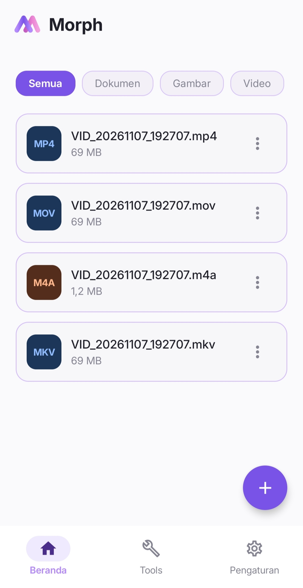

  

  <h1>Morph</h1>
  
<strong>Konverter File Offline untuk Android</strong>

  
Ubah format video, audio, gambar, dokumen PDF, hingga e-book langsung di perangkat Anda tanpa koneksi internet, tanpa iklan, dan tanpa mengunggah file ke server.

  

    
    
    
    
  

  

    <a href="#fitur-utama">Fitur Utama</a> &nbsp;•&nbsp;
    <a href="#format-yang-didukung">Format Didukung</a> &nbsp;•&nbsp;
    <a href="#cara-penggunaan">Cara Penggunaan</a> &nbsp;•&nbsp;
    <a href="#instalasi">Instalasi</a> &nbsp;•&nbsp;
    <a href="#privasi--izin">Privasi</a>
  

<h2 id="fitur-utama">Fitur Utama</h2>

<table>
  <tr>
    <td width="50%" valign="top">
      <h4>100% Offline &amp; Privasi Terjaga</h4>
      
Morph tidak memiliki izin akses internet. Seluruh proses konversi dan ekstraksi media diproses secara lokal di dalam ponsel Anda sehingga file pribadi tidak pernah keluar dari perangkat.

    </td>
    <td width="50%" valign="top">
      <h4>Konversi Instan dari Menu Share</h4>
      
Kirim satu atau beberapa file langsung dari Galeri, File Manager, atau aplikasi pesan ke <strong>Morph</strong> melalui menu Bagikan (Share) Android tanpa perlu membuka aplikasi terlebih dahulu.

    </td>
  </tr>
  <tr>
    <td width="50%" valign="top">
      <h4>Batch Conversion &amp; Pengelompokan Otomatis</h4>
      
Pilih banyak file dengan format berbeda sekaligus. Morph otomatis mengelompokkannya berdasarkan format asal sehingga setiap kelompok dapat diatur tujuan dan kualitasnya secara terpisah.

    </td>
    <td width="50%" valign="top">
      <h4>Berjalan Aman di Latar Belakang</h4>
      
Antrean konversi tetap berjalan meskipun layar mati atau Anda berpindah aplikasi, lengkap dengan indikator progres pada notifikasi sistem dan tombol pembatalan cepat.

    </td>
  </tr>
</table>

<h2>Tampilan Antarmuka & Alur Kerja</h2>

  <table>
    <tr>
      <td width="50%" align="center" valign="top">
        
          
        <strong>Beranda & Riwayat File</strong>
         
        Pemilih file cepat, filter kategori (Dokumen, Gambar, Video, Audio), serta pengelolaan riwayat hasil konversi lokal.
      </td>
      <td width="50%" align="center" valign="top">
        
          
        <strong>Share to Convert</strong>
         
        Mulai konversi langsung dari Galeri, File Manager, atau aplikasi lain melalui menu Bagikan (Share) bawaan Android.
      </td>
    </tr>
    <tr>
      <td width="50%" align="center" valign="top">
        
          
        <strong>Konversi Format Web Langsung</strong>
         
        Mengubah aset media dan vektor berbasis web (WebP, WebM, SVG) menjadi format standar yang siap digunakan secara offline.
      </td>
      <td width="50%" align="center" valign="top">
        
          
        <strong>Batch Processing Terkelompok</strong>
         
        Mengelompokkan banyak file secara otomatis berdasarkan ekstensi sumber dengan pengaturan format tujuan dan kualitas terpisah.
      </td>
    </tr>
  </table>

<h2 id="format-yang-didukung">Format yang Didukung</h2>

Morph menggabungkan mesin pemrosesan multimedia lokal, renderer vektor, dan parser dokumen bawaan untuk menangani berbagai kebutuhan konversi harian:

<table>
  <thead>
    <tr>
      <th align="left">Kategori</th>
      <th align="left">Format Asal (Input)</th>
      <th align="left">Format Tujuan (Output)</th>
      <th align="left">Kemampuan &amp; Opsi</th>
    </tr>
  </thead>
  <tbody>
    <tr>
      <td><strong>Video</strong></td>
      <td><code>MP4</code>, <code>MKV</code>, <code>MOV</code>, <code>WEBM</code>, <code>AVI</code></td>
      <td><code>MP4</code>, <code>MKV</code>, <code>MOV</code>, <code>WEBM</code>, <code>GIF</code></td>
      <td>Mendukung mode <strong>Instan</strong> (<em>stream copy</em> tanpa re-encode untuk kontainer kompatibel), kompresi resolusi/bitrate, serta pembuatan GIF proporsional.</td>
    </tr>
    <tr>
      <td><strong>Ekstraksi Audio</strong></td>
      <td><code>MP4</code>, <code>MKV</code>, <code>MOV</code>, <code>WEBM</code></td>
      <td><code>MP3</code>, <code>M4A</code>, <code>WAV</code>, <code>FLAC</code>, <code>OGG</code>, <code>OPUS</code></td>
      <td>Memisahkan jalur audio dari video secara langsung dengan pilihan preset kualitas (Rendah, Sedang, Tinggi).</td>
    </tr>
    <tr>
      <td><strong>Konversi Audio</strong></td>
      <td><code>MP3</code>, <code>M4A</code>, <code>AAC</code>, <code>WAV</code>, <code>FLAC</code>, <code>OGG</code>, <code>OPUS</code></td>
      <td><code>MP3</code>, <code>M4A</code>, <code>AAC</code>, <code>WAV</code>, <code>FLAC</code>, <code>OGG</code>, <code>OPUS</code></td>
      <td>Mendukung konversi antar-format kompresi maupun format <em>lossless</em> (WAV/FLAC).</td>
    </tr>
    <tr>
      <td><strong>Gambar Raster</strong></td>
      <td><code>PNG</code>, <code>JPG</code>, <code>JPEG</code>, <code>WEBP</code>, <code>BMP</code></td>
      <td><code>PNG</code>, <code>JPG</code>, <code>WEBP</code>, <code>BMP</code>, <code>PDF</code></td>
      <td>Penanganan latar belakang putih otomatis saat mengonversi gambar transparan ke JPG, serta opsi menggabungkan beberapa gambar menjadi satu dokumen PDF.</td>
    </tr>
    <tr>
      <td><strong>Grafik Vektor</strong></td>
      <td><code>SVG</code></td>
      <td><code>PNG</code>, <code>JPG</code>, <code>WEBP</code></td>
      <td>Mengubah file vektor SVG menjadi gambar siap pakai dengan mempertahankan transparansi penuh pada format PNG.</td>
    </tr>
    <tr>
      <td><strong>Dokumen PDF</strong></td>
      <td><code>PDF</code></td>
      <td><code>JPG</code>, <code>PNG</code>, <code>WEBP</code>, <code>PDF</code></td>
      <td>Mengekstrak setiap halaman PDF menjadi file gambar beresolusi tinggi atau mengompres ukuran dokumen PDF.</td>
    </tr>
    <tr>
      <td><strong>E-Book</strong></td>
      <td><code>EPUB</code></td>
      <td><code>TXT</code></td>
      <td>Mengekstrak isi dan urutan bab buku digital menjadi dokumen teks bersih yang ringan dibaca.</td>
    </tr>
  </tbody>
</table>

<h2 id="cara-penggunaan">Cara Penggunaan</h2>

<ol>
  <li><strong>Pilih File:</strong> Ketuk tombol tambah di beranda Morph untuk memilih satu atau banyak file dari penyimpanan perangkat, atau gunakan fitur <strong>Share</strong> dari aplikasi lain.</li>
  <li><strong>Atur Format &amp; Kualitas:</strong> Tentukan format tujuan untuk masing-masing kelompok file. Pilih preset kualitas (<em>Rendah</em>, <em>Sedang</em>, <em>Tinggi</em>, atau <em>Instan</em> jika format mendukung).</li>
  <li><strong>Mulai Konversi:</strong> Tekan tombol <strong>Konversi</strong>. Anda dapat memantau progres di layar atau meminimalkan aplikasi sementara proses berjalan di latar belakang.</li>
  <li><strong>Akses Hasil:</strong> Seluruh file hasil konversi otomatis tersimpan rapi di folder <code>Downloads/Morph</code> dan dapat langsung dibuka atau dibagikan dari tab Beranda.</li>
</ol>

<h2 id="instalasi">Instalasi</h2>

Morph tersedia dalam bentuk paket instalasi Android (<code>.apk</code>) yang siap langsung dipasang tanpa perlu melakukan kompilasi kode sumber:

<ol>
  <li>Buka halaman <a href="https://github.com/RizkyFauzi06/Morph/releases"><strong>Releases</strong></a> pada repositori ini.</li>
  <li>Unduh berkas <code>Morph-v1.0.0.apk</code> (atau versi terbaru yang tersedia) pada bagian <strong>Assets</strong>.</li>
  <li>Buka berkas APK yang telah diunduh di perangkat Android Anda. Jika diminta, izinkan instalasi aplikasi dari sumber ini pada pengaturan peramban atau pengelola file Anda.</li>
  <li>Selesaikan proses instalasi dan buka <strong>Morph</strong>.</li>
</ol>

  
<strong>Kompilasi dari Kode Sumber (Untuk Pengembang)</strong>

   
  
Pastikan Anda menggunakan <strong>Android Studio Ladybug (2024.2.1+)</strong> dengan <strong>JDK 21</strong> dan Android SDK API 26–36.

  <pre><code>git clone https://github.com/RizkyFauzi06/Morph.git
cd Morph
./gradlew assembleDebug</code></pre>
  
Hasil kompilasi APK akan berada di direktori <code>app/build/outputs/apk/debug/</code>.

<h2 id="privasi--izin">Privasi &amp; Izin</h2>

<table>
  <thead>
    <tr>
      <th align="left">Izin / Pengaturan Android</th>
      <th align="left">Tujuan</th>
      <th align="center">Status</th>
    </tr>
  </thead>
  <tbody>
    <tr>
      <td><code>POST_NOTIFICATIONS</code></td>
      <td>Menampilkan progres antrean konversi secara waktu nyata dan notifikasi selesai pada Android 13+.</td>
      <td align="center">Opsional</td>
    </tr>
    <tr>
      <td><code>FOREGROUND_SERVICE</code> &amp; <code>FOREGROUND_SERVICE_DATA_SYNC</code></td>
      <td>Menjaga proses konversi lokal tetap berjalan lancar saat Anda berpindah aplikasi atau mengunci layar.</td>
      <td align="center">Wajib</td>
    </tr>
    <tr>
      <td><code>Penggunaan Baterai Tidak Dibatasi</code> <em>(Setelan Sistem)</em></td>
      <td>Mencegah penghemat baterai Android menghentikan paksa konversi video atau audio berdurasi panjang di latar belakang (diatur manual melalui Info Aplikasi).</td>
      <td align="center">Direkomendasikan</td>
    </tr>
    <tr>
      <td><code>INTERNET</code></td>
      <td><strong>Dihilangkan sepenuhnya.</strong> Morph tidak dapat terhubung ke internet maupun mengirimkan data pengguna.</td>
      <td align="center">Tidak Digunakan</td>
    </tr>
  </tbody>
</table>

<h2 id="spesifikasi-teknis">Spesifikasi &amp; Lisensi</h2>

<ul>
  <li><strong>Bahasa &amp; UI:</strong> Kotlin, Jetpack Compose, AndroidX, &amp; Kotlin Coroutines (Apache License 2.0).</li>
  <li><strong>Pustaka Inti (Third-Party Engines):</strong>
    <ul>
      <li><strong>FFmpegKit Full (8.1.7)</strong> — Pemrosesan audio/video (Lisensi: <strong>GPL-3.0 / LGPL-3.0</strong>).</li>
      <li><strong>AndroidSVG (1.4)</strong> oleh Paul LeBeau — Rendering grafis vektor SVG (Lisensi: <strong>Apache License 2.0</strong>).</li>
      <li><strong>Android Native SDK</strong> — <code>PdfRenderer</code>, <code>PdfDocument</code>, &amp; <code>java.util.zip</code> untuk pemrosesan PDF dan arsip EPUB/ZIP.</li>
    </ul>
  </li>
  <li><strong>Lisensi Proyek Morph:</strong> Didistribusikan di bawah lisensi <a href="LICENSE"><strong>GNU General Public License v3.0 (GPL-3.0)</strong></a>.</li>
</ul>
 

  Dikembangkan oleh <strong>Rizky Fauzi</strong> • Offline-First Android Utility

